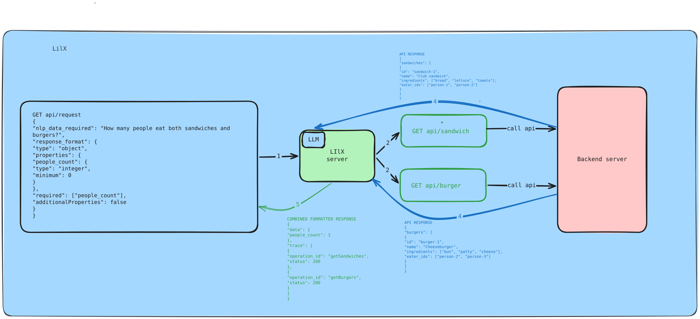

# lilx

> *Ask for data in plain language and get it back in the JSON shape you need.*

  

## What's in it for you

- Ask one question across the data sources your workspace has approved.
- Choose the fields and types you want in the answer.
- See which sources were called and whether they succeeded.
- Get a clear error when no approved source is selected or the answer fails shape validation.

## Features

- Lists the approved data operations available to callers.
- Selects relevant read-only operations for a natural-language request.
- Returns a JSON object checked against your JSON Schema.
- Keeps the call trace separate from your requested data.

## Doodle


## Quick Start

Install Go 1.25.6 or newer and Node.js. Set a valid Google Generative Language API key in your shell. The key stays on the server.

```sh
git clone https://github.com/Jay-1409/lilx.git
cd lilx
export GEMINI_API_KEY='your-google-api-key'
```

Start the sample backend in one terminal. It serves fixed test data on port 9000.

```sh
node test-backend/server.js
```

Start lilx in a second terminal from the repository root.

```sh
export GEMINI_API_KEY='your-google-api-key'
export LILX_BACKEND_URL='http://127.0.0.1:9000'
export LILX_OPENAPI_URL='http://127.0.0.1:9000/openapi.json'
export LILX_ALLOWED_OPERATIONS='listTickets,getCheckoutMetrics,listIncidents'
go run .
```

List the approved operations, then submit a request from a third terminal. A live request needs a working API key and access to the Google Generative Language endpoint.

```sh
curl --fail-with-body http://127.0.0.1:8080/v1/operations
curl --fail-with-body http://127.0.0.1:8080/v1/requests \
  -H 'Content-Type: application/json' \
  -d '{"nlp_data_required":"What is the checkout order error rate?","response_format":{"type":"object","properties":{"order_error_rate_percent":{"type":"number"}},"required":["order_error_rate_percent"],"additionalProperties":false}}'
```

The second response contains `data` in the requested shape and a separate `trace`. The sample backend contains demo data only. This implementation requires `response_format` to be a JSON Schema with `type: object`; an example JSON object is not accepted as a format template.

## Documentation

- [API and configuration](./docs/api.md)
- [Architecture and data flow](./docs/architecture.md)
- [Contributing](./docs/contributing.md)
- [Sample backend](./test-backend/README.md)

## License

[Apache License 2.0](./LICENSE).
