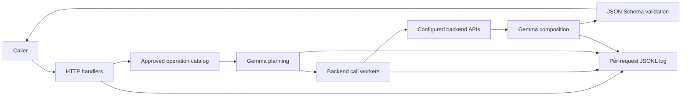

# Architecture

## Data flow

The server loads the configured OpenAPI 3.x specification at startup. It keeps supported GET operations in a catalog, then applies the operator's allowlist. Callers can list that approved catalog through `GET /v1/operations`.

For `POST /v1/requests`, the HTTP handler validates both input fields. Gemma proposes up to ten calls from the approved catalog. Application code rejects unapproved operations and undocumented parameters. Shared workers call the backend and collect JSON responses. Gemma then proposes the output object. Application code checks that object against the caller's JSON Schema and returns it with a separate call trace.

The source files map to these responsibilities:

| File | Responsibility |
| --- | --- |
| `main.go` | HTTP endpoints, request validation, planning, backend HTTP calls, model calls, and output validation. |
| `openapi.go` | OpenAPI loading and operation catalog. |
| `workers.go` | Shared backend workers and ordered result collection. |
| `requestlog.go` | Per-request JSONL exchange logs and URL redaction. |
| `test-backend/server.js` | Fixed local data source for integration tests. |

## Concurrency and limits

Backend calls share a worker pool across requests. The default pool has ten workers; set `LILX_WORKERS` from 1 to 100. Calls in one plan can run concurrently. Results and trace entries are returned in plan order. The first backend failure cancels the request; a failure trace includes calls completed by that point.

Each backend HTTP call has a 15-second timeout. Each Gemma call has a timeout of 600 seconds (10 minutes) by default, configurable with `LILX_MODEL_TIMEOUT_SECONDS`. Each model stage allows at most two attempts: one initial call and one correction for invalid output or retry after a model server error (HTTP 5xx). A server error retry waits one second and respects caller cancellation. The full product request has a 10-minute deadline shared across all attempts and backend work. Bruno requests also allow 10 minutes; callers must use a compatible timeout. Backend JSON is limited to 1 MiB per call, and model responses are limited to 128 KiB.

## Trust and visibility

The backend URL, OpenAPI URL, credentials, and allowlist come from server settings. Prompt text and upstream JSON are untrusted. The model proposes a plan and output, while application code enforces the allowlist, call count, parameter rules, and schema validation.

The returned trace records operation IDs and HTTP statuses. It does not provide field-level evidence. Per-request logs contain full request and response bodies, including prompts and backend data; they are for private operational inspection. See [API and configuration](./api.md) for the log format and endpoint behavior.
